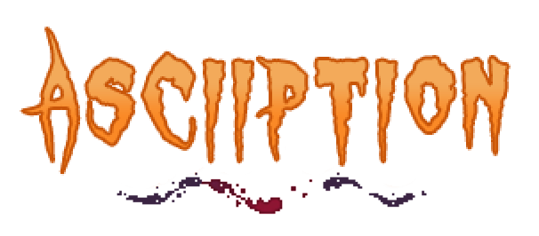
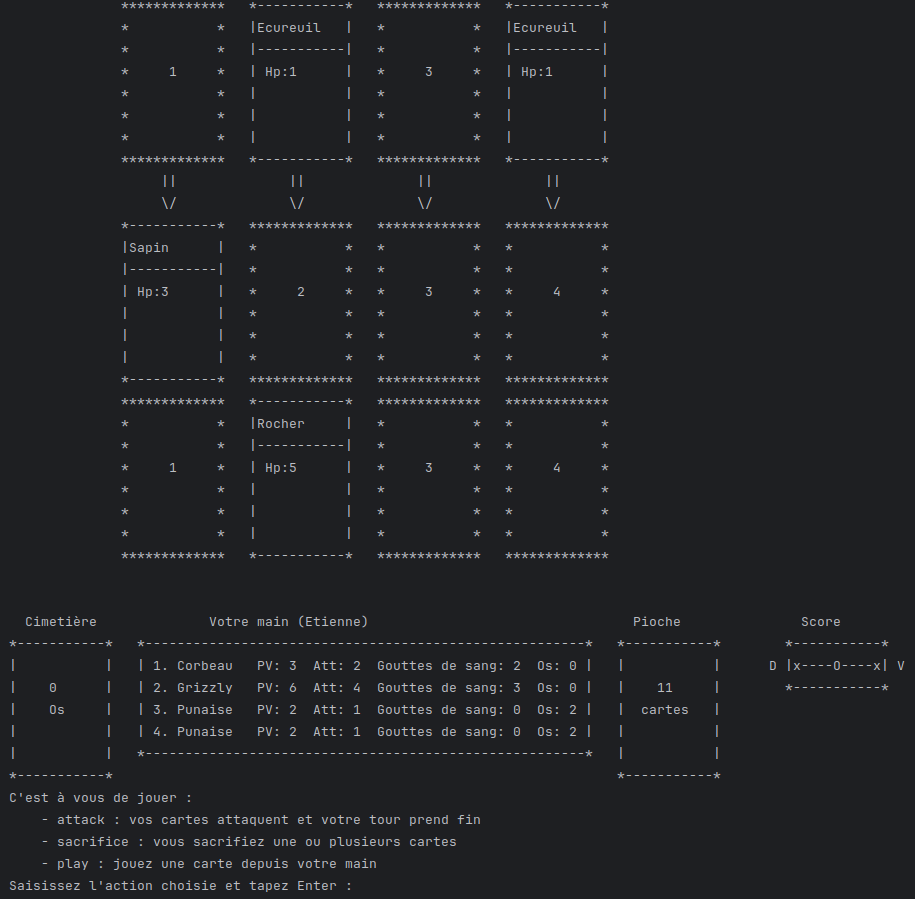
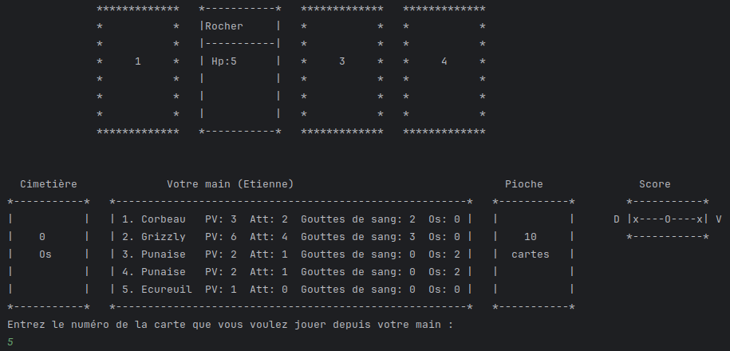
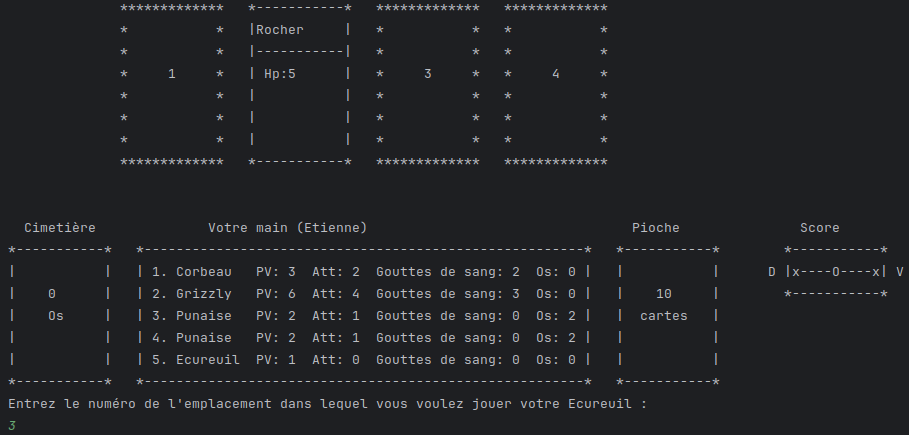
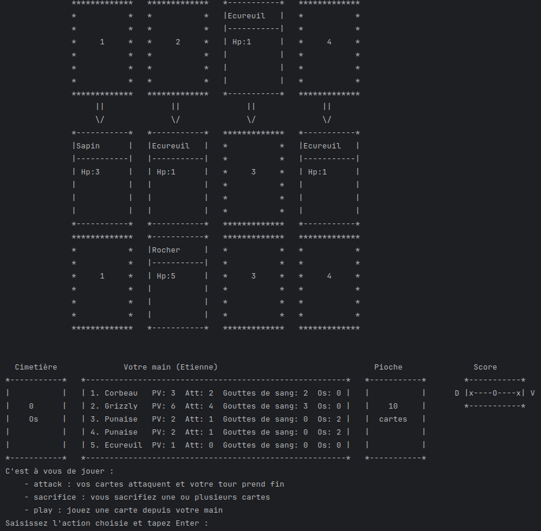
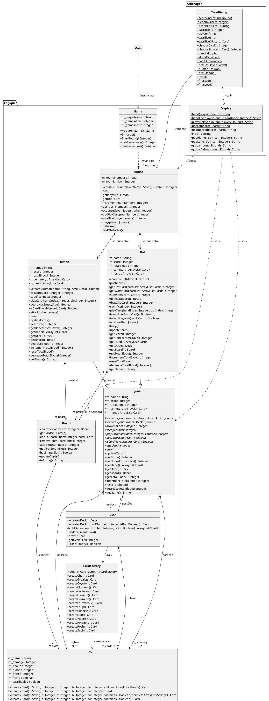

<p align="center"></p>

# ASCIIPTION

> *Un projet (très) inspiré du jeu de carte au tour par tour Inscryption, réalisé en Java.*

---
## Présentation du projet

**ASCIIption** est une SAE effectuée lors du deuxième semestre de ma première année de BUT informatique. La SAE consiste à coder une version simplifiée d'Inscryption en Java, avec un affichage console. <br>
Le jeu original est un jeu de cartes sur plateau où les joueurs invoquent des créatures ayant des statistiques et effets variés. Les créatures des deux camps s'affrontent dans le but de pouvoir attaquer directement le joueur adverse. <br>
Durant la SAE, les enseignants postaient régulièrement de nouvelles consignes pour nous guider progressivement vers un cahier des charges final.<br>
Les objectifs pédagogiques étaient :
- programmer en programmation orientée objet
- suivre les guidelines Java et appliquer les principes SOLID
- concevoir des tests unitaires pour garantir la fiabilité du code
- prendre des décisions d'implémentation cohérentes et pertinentes
- cartographier le projet en UML

<br>

| Contraites             |                                                                                    |
|------------------------|------------------------------------------------------------------------------------|
| Durée de développement | 5 semaines, de mai à juin 2026 *(en parallèle des cours, TD et TP)*                |
| Taille de l'équipe : 2 | <a href="https://github.com/T0M0R0W">Tom</a> <br>moi-même                          |
| Technologies utilisées | langage : Java <br>outils : GitHub, InteliJ IDEA                                   |

### Calendrier de développement

- lundi 4 mai : phase 1 dévoilée
- mardi 12 mai : début des séances de TPs dédiées au projet
- lundi 25 mai : début de la phase 2
- mercredi 10 Juin à 12h30 : rendu final
- de Jeudi 11 Juin à Vendredi 12 Juin : soutenances

Rendus hebdomadaires avant chaque Dimanche, 23h59 (les 17/05, 24/05, 31/05, 7/06 ).

---
## Description des fonctionnalités


### Plateau

<p align="center"></p>

Le plateau est constitué de deux lignes de quatre emplacements de cartes. Le joueur place ses cartes sur la ligne du bas, l'adversaire (un bot scripté, donc sans aléatoire) les place sur la ligne du haut. Le bot dispose d'une ligne "prévisionnelle" où il joue ses cartes, et celles-ci rejoignent la ligne active au tour suivant, permettant au joueur d'adapter son jeu aux actions du bot.<br>
A droite du joueur se trouve sa pioche. Il commence avec 4 cartes en main et pioche une carte par tour jusqu'à épuisement de son deck.<br>
A gauche de la main du joueur se trouve son cimetière, qui comptabilise le nombre de créatures qu'il a perdues.<br>
A droite de la pioche, une balance représente l'écart de score entre le joueur et le bot. Le premier qui atteint un écart de 5 points en sa faveur remporte la partie.

### Animaux

Chaque carte dispose

- d'un nombre de points d'attaque
- d'un nombre de points de vie
- d'un nombre de gouttes de sang (représente le nombre d'animaux de son plateau que le joueur ou le bot doit sacrifier pour pouvoir invoquer cette carte)
- d'un nombre d'os (représente le nombre d'animaux morts requis pour pouvoir invoquer cette carte)

Chacune des cartes peut apparaitre en plusieurs exemplaires dans la pioche, dans la main et sur le plateau.
Nom | Attaque      | Points de vie  | Gouttes de sang  | Os | Volant ? | Pouvoir
-------- |---------|---------|---------|----------------|-----|-----------|
Chat |0  |1  | 1  | 0         | non | Nombreuses Vies
Grizzly | 4| 6 | 3| 0 | non |
Coyote | 2 | 1 | 0 |4 | non |
Moineau | 1 | 2 | 1 | 0 | oui |
Corbeau |2 | 3| 2 | 0 | oui |
Ecureuil | 0 | 1 | 0 | 0 | non |
Hermine | 1 | 3 | 1 |0 | non |
Louveteau | 1| 1 | 1 |0  | non | Croissance
Loup |3 | 2 | 2 |0  | non |
Punaise | 1 | 2 | 0 | 2 | non |Puant
Elan |2 | 4 | 2 | 0 | Non | Coureur
Vipère | 1 |1| 2 | 0 | Non | Contact mortel
Porc-épic | 1 | 2| 1 | 0 | Non | Piques pointues

Certaines cartes disposent de pouvoirs
- Nombreuses vies :  la carte reste sur le plateau si elle est sacrifiée (ne peut être sacrifiée qu'une fois)
- Croissance : l'animal se transforme en loup au tour suivant (reste sur le même emplacement)
- Puant : réduit de 1 l'attaque de la carte lui faisant face
- Coureur : après avoir attaqué, la carte se déplace d'un emplacement vers la droite. Si l'emplacement vers la droite est bloqué, la carte se déplace vers la gauche. Si les emplacements vers la gauche et la droite sont bloquées, la carte ne se déplace pas
- Contact Mortel: si la carte inflige des dégâts à une autre créature (donc pas à un obstacle), la créature blessée meurt 
- Piques pointues : lorsqu'elle est attaquée, la carte inflige 1 point de dégât à la carte attaquante

### Obstacles

Au début de la partie, 2 obstacles sont placés sur le terrain, occupant un emplacement de carte du joueur et un emplacement de cartes de l'adversaire.<br>
Les obstacles disposent seulement de points de vie.<br>Ils protègent d'une attaque mais empêchent de poser une carte "animal" sur les emplacements qu'ils occupent. Il est cependant possible de détruire un obstacle en l'attaquant, comme une carte "animal" classique.
Nom | Points de vie      |
-------- |---------|
Rocher | 5         |     
Sapin | 3  |


### Déroulement d'un tour

- l'adversaire indique quelles cartes il jouera au tour suicant (représentées par une ligne supplémentaire de 4 emplacements de cartes au-dessus du plateau)
- le joueur pioche une carte et la place dans sa main
- le joueur peut placer autant de cartes qu'il le souhaite depuis sa main sur le plateau, tant que les conditions d'invocations sont satisfaites et qu'il lui reste au moins un emplacement libre

<details>
<summary>Exemple de phase de pose</summary>
<p align="center"></p>
<p align="center"></p>
</details>
<br>

- les cartes "animal" du joueur attaquent. Si une carte fait face à la carte "animal" attaquante, elle subit des dégats à hauteur des points de dégats de la carte attaquante
- si aucune carte ne fait face à une carte "animal" attaquante, les dégats sont infligés directement au bot (les cartes "animal" volantes attaquent directement l'adversaire, même si une carte leur fait face)
- les dégats sont comptabilisés
- les cartes annoncées par l'adversaire sont déplacées sur sa ligne active

<details>
<summary>Exemple : début du tour 1 et début du tour 2</summary>
Dans cet exemple, le joueur ne peut rien poser au premier tour (son deck étant mélangé aléatoirement).
<p align="center"></p>
<p align="center"></p>
</details>
<br>

- il peut alors annoncer les cartes de son tour suivant
- les cartes "animal" de l'adversaire attaquent selon les mêmes modalités que celles du joueur

Le jeu passe ensuite au tour suivant et répète cette boucle jusqu'à ce que l'écart de score entre les deux joueurs soit de 5, ce qui met fin à la partie. Le jeu est constitué de 3 parties, qu'il faut gagner à la chaine.<br>
Ces 3 parties sont différentes les unes des autres :
- au début de la première partie, le deck du joueur contient 15 cartes, majoritairement des écureuils
- à la fin de la deuxième partie, un choix est donné au joueur. Deux nouvelles cartes lui sont proposées, et il doit en choisir une qui sera ajoutée à son deck.


### Pierre de sacrifice

Mécanique supplémentaire qui se déclenche à la fin de la deuxième partie. Après que le joueur ait choisi une nouvelle carte et l'ait intégrée à son deck, il doit choisir une carte à sacrifier, dont il récupèrera le pouvoir (si la carte en possède un), et pourra l'ajouter à une carte "animal" de son deck.

---
## Organisation des classes

<details>
<summary>Diagramme des classes en UML</summary>
<p align="center"></p>
</details>
<br>


---
## Installer le programme


Le jeu est resté au stade de projet et nous n'avons pas développé d'installateur. Il est néanmoins possible de l'exécuter via un IDE prenant en charge Java.<br>
Sous Linux :

- pré requis, installer InteliJ IDEA : https://www.jetbrains.com/idea/
- cloner le dépôt dans un terminal : `git clone https://github.com/Romain-Pampagnin/Asciiption.git`
- ouvrir le projet avec InteliJ
- exécuter le fichier `src/Main`

---
## Architecture du projet

```
.
├── ascii                               # dossier des images en ASCII pour les cartes (non utilisées)
│   ├── chat.txt
│   ├── corbeau.txt
│   ├── coyote.txt
│   ├── ecureuil.txt
│   ├── hermine.txt
│   ├── loup
│   ├── moineau.txt
│   └── punaise.txt
├── assets                              # ressources pour le README
│   ├── logo.png
│   ├── screenshot_play1.png
│   ├── screenshot_play2.png
│   ├── screenshot_terrain_tour1.png
│   ├── screenshot_terrain_tour2.png
│   └── uml.png
├── deps
│   ├── hamcrest-core-1.3.jar
│   └── junit-4.13.2.jar
├── out
│   ├── production
│   │   └── project-inscryption
│   │       ├── Affichage               
│   │       │   ├── Display.class
│   │       │   └── TurnDialog.class
│   │       ├── Logique                
│   │       │   ├── Board.class
│   │       │   ├── Bot.class
│   │       │   ├── Card.class
│   │       │   ├── CardFactory.class
│   │       │   ├── Deck.class
│   │       │   ├── Game.class
│   │       │   ├── Human.class
│   │       │   ├── Joueur.class
│   │       │   └── Round.class
│   │       └── Main.class
│   └── test                            
│       └── project-inscryption
│           ├── BoardTest.class
│           ├── CardTest.class
│           ├── DisplayTest.class
│           └── JoueurTest.class
├── project-inscryption.iml
├── README.md
├── src                                 # classes gerant l'affichage dans la console
│   ├── Affichage
│   │   ├── Display.java
│   │   └── TurnDialog.java
│   ├── Logique                         # classes implémentant la logique du jeu
│   │   ├── Board.java
│   │   ├── Bot.java
│   │   ├── CardFactory.java
│   │   ├── Card.java
│   │   ├── Deck.java
│   │   ├── Game.java
│   │   ├── Human.java
│   │   ├── Joueur.java
│   │   └── Round.java
│   └── Main.java
├── tests                               # tests unitaires
│   ├── BoardTest.java
│   ├── CardTest.java
│   ├── DisplayTest.java
│   ├── GameTest.java
│   └── JoueurTest.java
├── TODO.md
└── uml
    └── UML.puml                        # diagramme UML de la SAE

```


---
## Limites et axes d'amélioration

### Fonctions non implémentées
- ajout de carte dans le deck du joueur à la fin de la 2ème partie
- pierre de sacrifice
- pouvoir "nombreuses vies"
- pouvoir "coureur"


### Tests unitaires

Certaines fonctionnalités et méthodes n'ont pas été testées via des tests unitaires. Il nous a manqué du temps pour pouvoir écrire et mettre en place l'ensemble des tests nécessaires.

### Complétion du jeu et gestion du bot

Comme demandé dans le cahier des charges, les actions du bot sont scriptées, mais nous voulions un bot capable de fonctionner sans script, à l'aide de fonctions d'attribution de valeur aux cartes. Le bot chercherait toujours à maximiser la valeur totale des cartes sur son terrain, et chercherait à attaquer en priorité les emplacements en face desquels le joueur ne place aucune carte. Nous n'avons pas pu développer l'entièreté de cette fonctionnalité, bien que des fonctions aient été développées dans ce sens (`getBestCard()` et `getWorstCard()` pour évaluer la valeur d'une carte, par exemple).
<br>
En l'état, notre ébauche ne permet pas de jouer plusieurs parties d'affilée. Les actions scriptées du bot s'arrêtent à la fin du 4ème tour. Nous avons manqué de temps pour scripter plusieurs parties. Chacune d'elle devait comporter un nombre de tours suffisant pour être certain d'arriver à une victoire, une défaite ou un match nul.

---
## Retour d'expérience

Cette SAE a été pour moi une source de beaucoup de frustration, pour plusieurs raisons
- le sujet était pensé pour ne pas pouvoir être complété à 100%
- nous avions 2 autres SAE à mener en parallèle, en plus de nos révisions et partiels
- au sein du binome, la gestion du temps, l'investissement et la méthode de travail étaient divergentes

Elle m'a cependant permis de mettre en pratique les bases de la programmation orientée objet, et de mieux comprendre ses concepts. <br>
A distance de la SAE, je constate que ma compréhension et mon implémentation de la POO ont bien évolué. Je suis beaucoup plus à l'aise et rigoureux dans ma structuration du code et l'attribution des responsabilités. Des concepts qui me paraissaient très théoriques et verbeux sont plus clairs à présent.


---
## Crédits et licence
IUT Robert Schuman, département informatique : encadrement, sujet, conseils
<br>
Licence MIT, voir le fichier LICENSE